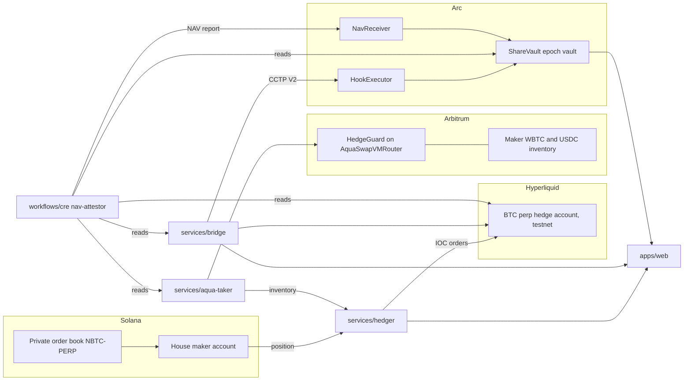
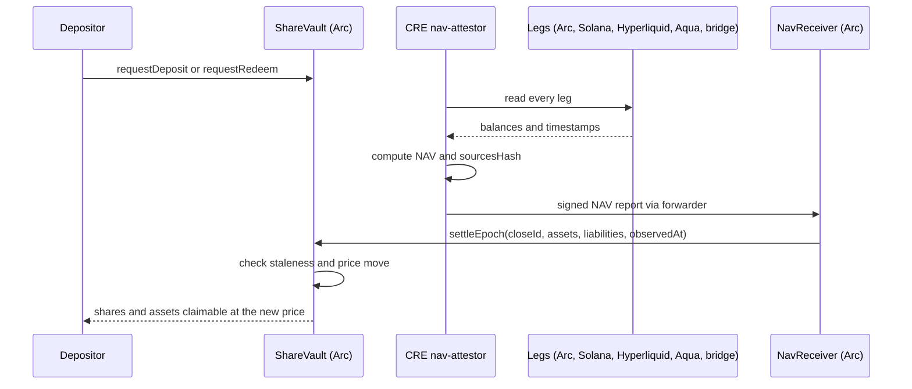

# NoirWire

Hedge, fund and prove a market maker's BTC inventory across chains, with one USDC vault underneath.

NoirWire runs a private perpetual order book on Solana. Its house market maker quotes `NBTC-PERP`, a BTC perp offered at up to 100x on Solana devnet, and builds up BTC exposure with every fill. That exposure is a risk, and the money that backs it sits on several chains at once: a Solana maker account, a Hyperliquid hedge account, an Arbitrum inventory pool and USDC in transit between them.

This repository is the answer. A hedger keeps net exposure near zero on Hyperliquid. A 1inch Aqua strategy lets takers buy the inventory back, but only in the hedge direction. One epoch vault on Arc holds the shared USDC, and a Chainlink CRE workflow reads every leg, computes NAV and writes it onchain, where the vault settles each epoch at that NAV.

> The contracts have not been audited. Do not use them with real funds.

## Architecture



An epoch close, from report to settled price:



## How it works

1. The house maker quotes the private `NBTC-PERP` book on Solana. Every fill changes its net BTC position.
2. The hedger polls that position and trades the opposite side of the BTC perp on Hyperliquid testnet with IOC orders. It holds when it cannot see a fresh position.
3. The leftover inventory is offered through a 1inch Aqua strategy. `HedgeGuard`, an Extruction guard behind the official `AquaSwapVMRouter`, accepts a fill only in the hedge direction, inside the size, the price band and an oracle band.
4. One USDC epoch vault on Arc backs every leg. Users deposit on Arc directly, or from Solana through Circle CCTP V2 and a `HookExecutor` relay.
5. The bridge service moves treasury USDC between Arc, Solana and HyperCore, and records every transfer with its attester so funds in transit are counted once.
6. Every five minutes a Chainlink CRE workflow reads all legs, computes NAV and hedge margin health, and writes a report to `NavReceiver` on Arc.
7. The vault settles each epoch at that NAV. The web app shows state, money movement and the NAV proof, with fills aggregated to protect the maker's trading.

## Rebalancing

Margin on Hyperliquid and collateral on Solana drift as the book trades. Two loops put the money back where it is needed. Both use the one Arc vault and Circle CCTP V2.

**Hedge margin (from the vault).** When Hyperliquid margin is low or high, the Chainlink CRE workflow writes a top-up intent onchain to `NavReceiver`. The bridge watches for that event. Only such an onchain intent can make it release USDC from the Arc vault. It then moves the USDC with CCTP V2 to Hyperliquid, or, when margin is too high, brings the surplus back to the vault. A request over the bridge's HTTP API can never release vault funds.

**Maker collateral (no vault).** The Solana market maker's positions are private. So the maker decides for itself when it holds too much or too little collateral, and asks the bridge to move it. The request carries an amount and a direction, never a position, equity or fill. The bridge moves a surplus to Hyperliquid, or tops the maker up from Hyperliquid. These two routes never touch the vault.

The bridge has six routes:

| Route | Moves | Trigger |
| --- | --- | --- |
| `arc-hypercore` | Vault USDC to the Hyperliquid account | Onchain top-up intent (margin low) |
| `hypercore-arc` | Hyperliquid surplus back to the vault | Onchain top-up intent (margin high) |
| `solana-hypercore` | Maker surplus to Hyperliquid | Maker request, direction `out` |
| `hypercore-solana` | Hyperliquid USDC to the maker, to top it up | Maker request, direction `in` |
| `solana-arc` | A Solana deposit into the vault, through `HookExecutor` | A depositor, from the web app |
| `arc-solana` | Arc USDC to the Solana account | A top-up intent for that route |

What has run, and where: the watcher, the vault release, the return step and the maker request API run only on a local chain with mock attestations, and the two Solana routes have run on a cloned local validator. No transfer has been sent over a public testnet, and the `hypercore-arc`, `solana-hypercore` and `hypercore-solana` routes have not touched Circle's HyperCore forwarding at all. The CRE workflow has only been simulated, never deployed to a DON. A maker-side top-up lands in the maker's own token account, not yet in its order book seat. The first live run is described in [docs/testnet.md](docs/testnet.md).

## Components

| Path                  | What it does                                                                                         | Chain                  | Status                                                                     |
| --------------------- | ---------------------------------------------------------------------------------------------------- | ---------------------- | -------------------------------------------------------------------------- |
| `contracts/vault`     | `ShareVault`, `NavReceiver`, `HookExecutor`: async epoch vault, CRE report consumer, CCTP hook relay | Arc                    | Local chain with mocks; Arc testnet deploy script included; unaudited      |
| `contracts/aqua`      | `HedgeGuard` swap guard for a 1inch Aqua strategy                                                    | Arbitrum               | Arbitrum One fork only; nothing is sent to a public network                |
| `services/hedger`     | Polls the maker position, hedges on Hyperliquid, journals every order                                | Hyperliquid testnet    | Mock venue tested; testnet mode wired, first live order not yet exercised  |
| `services/aqua-taker` | Ships the guarded Aqua strategy, sets its hedge target, serves inventory for NAV; the fork also runs a taker that only exercises fills | Arbitrum fork          | Fork only; nothing is sent to a public network                             |
| `services/bridge`     | CCTP V2 treasury executor with six routes, onchain top-up watcher, maker rebalance API               | Arc, Solana, HyperCore | Local mode and cloned Solana validator tested; no public testnet burn sent |
| `workflows/cre`       | `nav-attestor` CRE workflow                                                                          | Arc                    | Compiles and simulates; not deployed to a DON                              |
| `apps/web`            | Status, money and NAV proof pages, plus a deposit flow from Arc or Solana                            | Arc, Solana            | Local Next.js app; Solana deposit not yet signed by a wallet on devnet     |
| `packages/shared`     | Shared schemas, units and trust codes                                                                | n/a                    | Library                                                                    |
| `docs/interfaces.md`  | Units, report encodings, hook data, ports                                                            | n/a                    | Reference                                                                  |

## Quick start

Prerequisites:

- Node 24 or newer and pnpm 11 (`packageManager` is `pnpm@11.25.0`)
- [Foundry](https://book.getfoundry.sh/) (`forge`, `anvil`)
- Solana CLI with `solana-test-validator`, only for `make solana-up`
- The CRE CLI and bun, only for `make cre-simulate`
- Optional: an archive-capable `ARBITRUM_RPC_URL` for a stable Aqua fork

Everything local is driven from the root `Makefile`. Run `make help` for the full list.

```sh
make install       # pnpm install
make check         # types, lint, forge fmt and forge test (aqua fork tests only if the fork is up)
make test          # unit tests everywhere, no fork needed
make chains-up     # anvil arc-local :8545 (chain 31337) and an Arbitrum One fork :8546 (chain 42161)
make deploy-local  # vault contracts onto arc-local, writes contracts/vault/deployments/local.json
make up            # chains, deploy, hedger, bridge, aqua taker bot and web
make status        # recorded PIDs and which ports answer
make demo          # offline end to end: hedger mock, bridge local e2e, aqua fork demo, CRE compile (PASS/FAIL each)
make down          # stops exactly the PIDs recorded under .run/
```

Background processes keep a PID file and log under `.run/` (gitignored). If a node already listens on 8545 or 8546 with the right chain id, `chains-up` reuses it and `down` leaves it alone. Override ports with `ARC_PORT`, `FORK_PORT`, `WEB_PORT`; set `ARBITRUM_RPC_URL` (and optionally `FORK_BLOCK`) for the fork.

Targets that touch a public testnet (`deploy-arc-testnet`, `hedger-testnet-up`, `bridge-testnet-up`, `testnet-up`) refuse to run unless `CONFIRM=testnet` is set. To bring the system up on public testnets, follow [docs/testnet.md](docs/testnet.md); `testnet-up` starts the bridge and the hedger once the required environment is set. `make solana-up` runs the bridge's cloned CCTP validator test (read-only against devnet), and `make cre-simulate` runs the CRE workflow simulation.

Default local ports: hedger 8701, bridge 8702, Aqua inventory API 8703, web 3000.

### Keys

Testnet signing keys live in the macOS login Keychain (service `noirwire-ethglobal`, one entry per role: deployer, operator, relayer, hl-agent, taker, solana-operator, solana-depositor). They are never printed and never written to disk. The testnet targets read only the keys they need straight into the service's environment, and Solana keys are handed over as a `/dev/fd` path, not a file.

```sh
make keys-init       # run by the human: generate a fresh key per role; prints role and address only (FORCE=1 replaces)
make keys-addresses  # role and public address, never the key
```

`make keys-init` passes each key to the `security` tool on its command line for a moment, which is fine on a single-user Mac. The old plaintext `.keys/` folder is legacy: `make keys-migrate` imports it once, after which it can be deleted. `.claude/settings.json` denies AI assistants access to `.keys/` and to Keychain reads.

## Safety and trust

- **Trust labels.** Every number in the app carries its source: `onchain`, `venue-api` or `operator-supplied`. Every bridge transfer carries its attester: `circle-iris` or `local-test-attester`. A transfer signed by the local test attester is never shown as a Circle transfer.
- **HedgeGuard.** A fill must match the allowed direction, fit the remaining size, sit inside the price band and stay within `maxDeviationBps` of a fresh, positive oracle answer. A wrong-way fill reverts onchain.
- **Vault.** A report older than `maxReportAge` or not newer than the last settlement is rejected. A price move beyond `maxPriceMoveBps` pauses new requests until the owner acknowledges it. No settlement within `maxEpochGap` halts new deposits. Operator moves of idle USDC are capped and limited to allowlisted destinations, and the caps start at zero.
- **Hedger.** If it cannot read a fresh venue state or maker position it holds, goes `blind`, and tells the maker to quote reduce-only. Orders are journaled before they are sent, and an order with an unknown outcome blocks all new orders until it is reconciled.
- **Bridge.** Per-transfer and daily caps, a destination allowlist, an append-only journal, and no burn is ever repeated for the same transfer.
- **NAV.** The CRE run throws and writes nothing if any source is missing or stale. Holders still trust the operator for the legs Arc cannot verify (Solana maker, Hyperliquid, Aqua inventory, in-transit transfers); see [contracts/vault/README.md](contracts/vault/README.md).
- **Web privacy.** Fills are grouped into 10 second buckets, sizes are rounded, hedges are netted, and a bucket is published only once it is 20 seconds old. A source that is down shows as "not connected", never as zero.

## Repository layout

```text
apps/
  web/              Next.js status, flow and NAV proof pages, deposit flow
contracts/
  vault/            ShareVault, NavReceiver, HookExecutor (Foundry)
  aqua/             HedgeGuard for 1inch Aqua (Foundry)
services/
  hedger/           Position poller and Hyperliquid hedger
  bridge/           CCTP V2 treasury bridge and HTTP API
  aqua-taker/       Aqua strategy, hedge target, inventory API, fork-only taker
workflows/
  cre/              nav-attestor Chainlink CRE workflow
packages/
  shared/           Schemas, units, trust and leg codes
  ui/               Shared React components
  eslint-config/    Shared lint config
  typescript-config/ Shared tsconfig files
docs/
  interfaces.md     Units, encodings, ports
  testnet.md        Runbook from funded wallets to a running system
Makefile            Local stack entry points
```

Each package has its own README with details: [contracts/vault](contracts/vault/README.md), [contracts/aqua](contracts/aqua/README.md), [services/hedger](services/hedger/README.md), [services/bridge](services/bridge/README.md), [workflows/cre](workflows/cre/README.md), [apps/web](apps/web/README.md). Encodings and units are fixed in [docs/interfaces.md](docs/interfaces.md).

## Built with

- **Circle CCTP V2 and Arc.** Cross-chain USDC transfers and hook-based Solana deposits; Arc testnet is the home of the vault and pays gas in USDC.
- **Chainlink CRE.** The `nav-attestor` workflow reads every leg with consensus and delivers the NAV report through the forwarder to `NavReceiver`. Chainlink price feeds value WBTC.
- **1inch Aqua.** The hedge outlet uses the official Aqua registry and `AquaSwapVMRouter`, unmodified. See [contracts/aqua/README.md](contracts/aqua/README.md) for the attribution and what is official versus ours.
- **Hyperliquid.** The BTC perp on testnet is the hedge venue, and HyperCore receives hedge margin through the bridge.
- **MagicBlock.** Infrastructure for the private order book on Solana. The book itself runs outside this repository, which reads it through the hedger's `BOOK_API_URL`.
